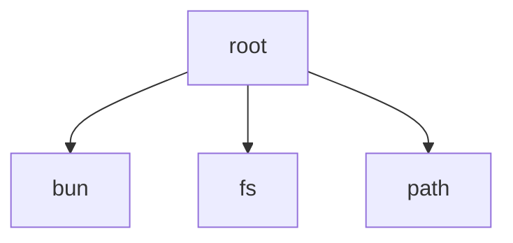

# Root Module

[← Back to INDEX](../../INDEX.md)

**Type:** root | **Files:** 36

## Files

| File | Lines | Large |
| ---- | ----- | ----- |
| `Edx/EdxApp.swift` | 831 | 📊 |
| `Edx/Services/AgentConfigurationService.swift` | 1610 | 📊 |
| `Edx/Services/AgentDetectionService.swift` | 252 |  |
| `Edx/Services/AtomFeedUpdateService.swift` | 557 | 📊 |
| `Edx/Services/CLIExecutor.swift` | 430 |  |
| `Edx/Services/ChecksumVerifier.swift` | 78 |  |
| `Edx/Services/CompatibilityChecker.swift` | 124 |  |
| `Edx/Services/CustomProviderService.swift` | 340 |  |
| `Edx/Services/DirectAuthFileService.swift` | 493 |  |
| `Edx/Services/FallbackSettingsManager.swift` | 367 |  |
| `Edx/Services/GLMQuotaFetcher.swift` | 186 |  |
| `Edx/Services/ImageCacheService.swift` | 131 |  |
| `Edx/Services/KeychainHelper.swift` | 225 |  |
| `Edx/Services/LanguageManager.swift` | 115 |  |
| `Edx/Services/LaunchAtLoginManager.swift` | 189 |  |
| `Edx/Services/Logger.swift` | 124 |  |
| `Edx/Services/ManagementAPIClient.swift` | 732 | 📊 |
| `Edx/Services/NotificationManager.swift` | 334 |  |
| `Edx/Services/Proxy/CLIProxyManager.swift` | 2351 | 📊 |
| `Edx/Services/Proxy/FallbackFormatConverter.swift` | 109 |  |
| `Edx/Services/Proxy/ProxyBridge.swift` | 1093 | 📊 |
| `Edx/Services/Proxy/ProxyStorageManager.swift` | 424 |  |
| `Edx/Services/ProxyConfigurationService.swift` | 96 |  |
| `Edx/Services/RequestTracker.swift` | 192 |  |
| `Edx/Services/ShellProfileManager.swift` | 121 |  |
| `Edx/Services/StatusBarManager.swift` | 272 |  |
| `Edx/Services/StatusBarMenuBuilder.swift` | 1470 | 📊 |
| `Edx/Services/Tunnel/CloudflaredService.swift` | 266 |  |
| `Edx/Services/Tunnel/TunnelManager.swift` | 254 |  |
| `Edx/Services/UpdaterService.swift` | 168 |  |
| `Edx/Services/WarmupService.swift` | 185 |  |
| `Edx/Services/WarpService.swift` | 83 |  |
| `Edx/ViewModels/AgentSetupViewModel.swift` | 456 |  |
| `Edx/ViewModels/LogsViewModel.swift` | 82 |  |
| `Edx/ViewModels/QuotaViewModel.swift` | 1982 | 📊 |
| `scripts/capture-screenshots.ts` | 763 | 📊 |

## Documentation

- [outline.md](outline.md) - Symbol maps for large files
- [memory.md](memory.md) - Warnings and TODOs

---

## External Dependencies

Dependencies from other modules:

- `bun`
- `fs`
- `path`
