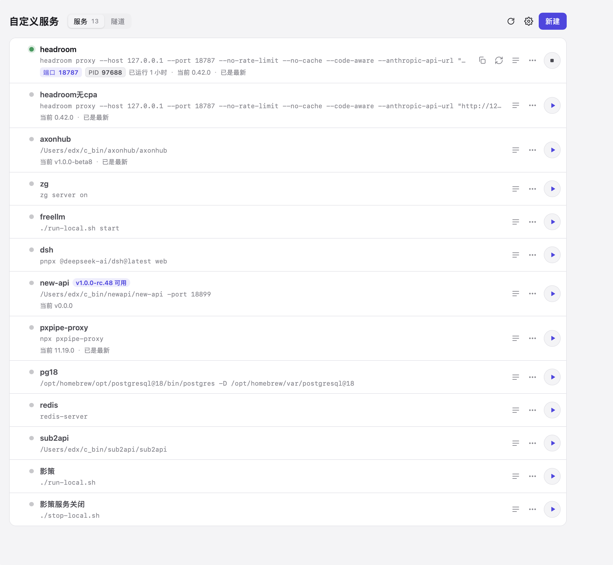
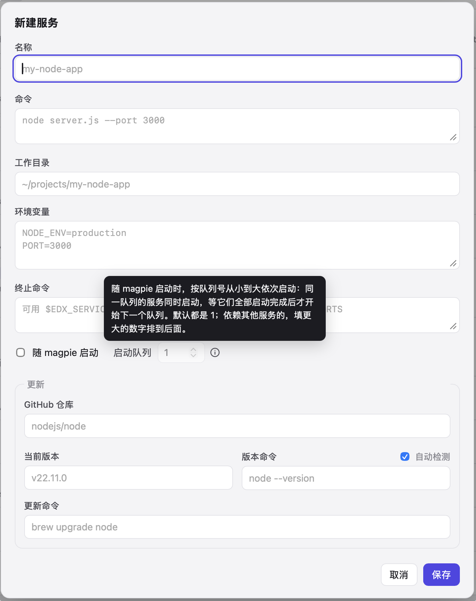
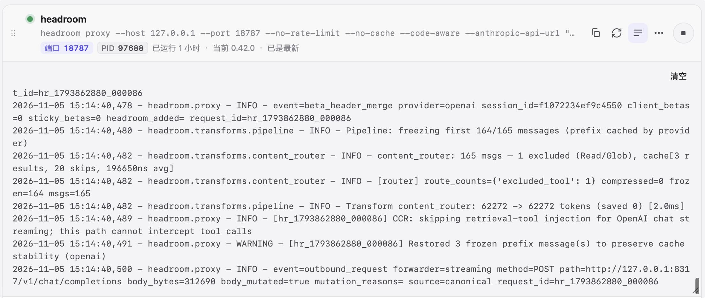
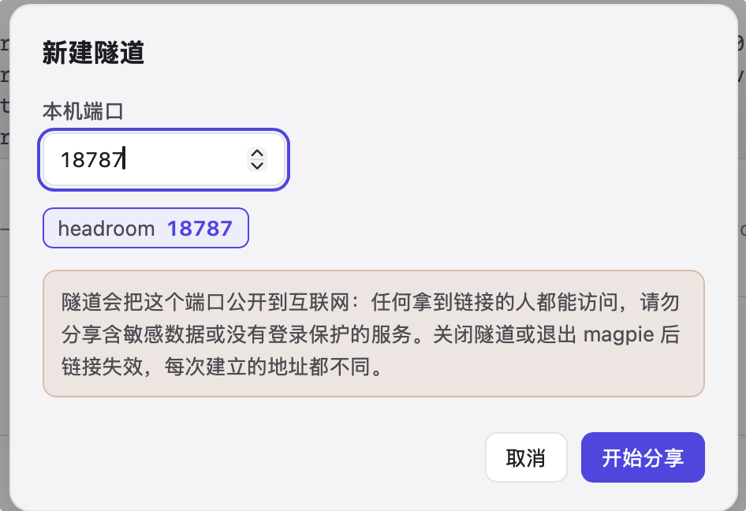
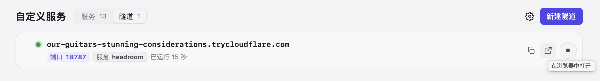

<div align="center">


# Edx 自定义服务

**常驻本地命令，在 magpie 里一处托管**


[特性](#特性) · [快速开始](#快速开始) · [使用示例](#使用示例) · [配置项](#配置项)

</div>

<p align="center"></p>

本地代理、网关、开发服务器这类要一直开着的命令，不用再各开一个终端窗口守着。这个 magpie 插件在侧边栏加一个「自定义服务」页面：统一启停、看实时日志、发现新版本并一键更新，还能把端口临时分享到公网。

## 特性

- **🛡️ 进程管得住** — 每个服务带 `EDX_SERVICE_ID` 环境标记并单独成进程组，连同派生的子孙进程一起追踪；停止时先执行你写的终止命令，再 SIGTERM → SIGKILL 收尾。
- **🔁 magpie 重启不掉线** — 服务独立于 magpie 运行，magpie 重启或插件更新后自动重新接管，日志不断档。
- **🚦 按队列有序启动** — 「随 magpie 启动」的服务按启动队列（1–99）分批拉起，前一批全部就绪并稳定 1.5 秒才启动下一批。
- **🔔 新版本自己找上门** — 绑定 GitHub 仓库后每 12 小时查一次最新 Release；版本命令自动探测，有新版时一键执行更新命令，也可以忽略这个版本。
- **🌐 一键分享到公网** — 基于 Cloudflare 免费快速隧道，任意本机端口几秒内得到 `https://*.trycloudflare.com` 地址，无需 Cloudflare 账号。
- **📋 地址点一下就有** — 自动识别监听端口，点端口标签复制 `http://127.0.0.1:端口`；列表可拖动排序，删除可撤销。

## 快速开始

前置：macOS + [magpie](https://usemagpie.ai)（插件由 magpie 自带的 Bun 运行，无需安装依赖）；使用隧道另需 `cloudflared`。

```bash
magpie plugin add /path/to/magpie-plugin/edx-services
```

```bash
brew install cloudflared
```

启用插件后，magpie 侧边栏的「插件」分组里出现「自定义服务」，点开即可使用。

## 使用示例

**托管一个 Node 服务**：点「新建」，填写：

| 字段 | 示例 |
| --- | --- |
| 名称 | `my-node-app` |
| 命令 | `node server.js --port 3000` |
| 工作目录 | `~/projects/my-node-app` |
| 环境变量 | `NODE_ENV=production`、`PORT=3000` |
| 随 magpie 启动 / 启动队列 | 打开 / `2` |



保存后点「启动」：状态变为「运行中」，行内出现端口 `3000` 与 PID 标签，「日志」里能看到实时输出。



**跟踪版本并一键更新**：在同一个服务的「更新」部分补上：

| 字段 | 示例 |
| --- | --- |
| GitHub 仓库 | `nodejs/node` |
| 版本命令 | 开着「自动检测」即可，会探测出 `node --version` |
| 更新命令 | `brew upgrade node` |

有新版本时行内显示「v… 可用」，可以「立即更新」「查看发布页」「忽略此版本」或「标记为当前版本」。匿名查询每小时 60 次，在设置里填「GitHub 访问令牌」可以提高额度。


**分享到公网**：在服务的 ⋯ 菜单选「分享到公网…」，或切到「隧道」标签页填任意端口，点「开始分享」。地址出来后可以复制、在浏览器中打开或关闭隧道。

| 分享到公网 | 隧道列表 |
| --- | --- |
|  |  |

## 配置项

<details>
<summary><b>插件选项与环境变量</b></summary>

插件选项用 `magpie plugin options magpie-edx-services '<json>'` 设置。

| 名称 | 类型 | 默认值 | 说明 |
| --- | --- | --- | --- |
| 选项 `port` | number | `3427` | 插件本地面板与 API 的端口（1024–65535） |
| 选项 `token` | string | 首次打开自动生成 | 面板访问令牌（≥32 位） |
| `EDX_SERVICES_PORT` | number | — | 覆盖面板端口，优先于选项 `port` |
| `EDX_SERVICES_LEADER` | `1` / `0` | 自动判断 | 强制当前插件宿主接管 / 不接管服务（调试用） |
| `GITHUB_TOKEN` / `GH_TOKEN` | string | — | 面板未保存令牌时用于查询 Release；都没有再试 `gh auth token` |

</details>

<details>
<summary><b>面板设置</b></summary>

| 设置 | 类型 | 默认值 | 说明 |
| --- | --- | --- | --- |
| 自动检查更新 | boolean | `true` | 定时查询已绑定仓库的最新 Release |
| 检查间隔 | number（小时） | `12` | 1–168 |
| GitHub 访问令牌 | string | — | 保存前向 GitHub 验证；只用于查询公开仓库，无需勾选任何权限 |

</details>

<details>
<summary><b>服务字段</b></summary>

| 字段 | 类型 | 默认值 | 说明 |
| --- | --- | --- | --- |
| 名称 | string | — | 必填 |
| 命令 | string | — | 必填，在登录 shell（`-i -l -c`）中执行 |
| 工作目录 | string | 用户主目录 | 运行目录 |
| 环境变量 | 每行 `KEY=value` | — | 额外环境变量 |
| 终止命令 | string | — | 停止时先执行（最多等 30 秒），可用 `$EDX_SERVICE_PID`、`$EDX_SERVICE_PIDS`、`$EDX_SERVICE_PORTS` |
| 随 magpie 启动 | boolean | 关 | 每个 magpie 会话只自动启动一次 |
| 启动队列 | number | `1` | 1–99，自动启动时从小到大分批 |
| GitHub 仓库 | `owner/repo` | — | 绑定后才检查新版本 |
| 当前版本 | string | 自动检测 | 由版本命令得出，也可手填 |
| 版本命令 | string | 自动检测 | 手动修改即关闭自动检测 |
| 更新命令 | string | — | 点「立即更新」时执行 |

</details>

<details>
<summary><b>数据、令牌与安全</b></summary>

- **数据目录**：`<magpie 配置目录>/edx-services/`，含 `services.json`、`runtime.json`、`logs/`、`tunnels/`。
- **面板令牌**：首次打开时生成，保存在 magpie `plugins.json` 中本插件的选项里；每个 API 请求都要带 `x-edx-token`。
- **GitHub 令牌**：单独存成权限 `0600` 的文件，不写进 `services.json`，也不进日志；面板只显示末 4 位。
- **网络边界**：面板只监听 `127.0.0.1` 并校验 `Host` 头，其他网页无法跨站操作服务；「打开链接」只放行 GitHub 与本插件建立的隧道地址。
- **隧道即公网入口**：拿到地址的人都能访问对应端口，不用时请关闭。

</details>

<details>
<summary><b>运行方式</b></summary>

```
magpie 窗口
└─ 侧边栏页面 page/（沙盒框架，不能联网）
     └─ 准备令牌后跳转 ──▶ 插件宿主（Bun）
                          ├─ lib/server.mjs   127.0.0.1:3427 面板 web/ 与 API
                          ├─ lib/manager.mjs  启停、启动队列、更新检查
                          ├─ lib/process.mjs  进程标记与进程组追踪
                          ├─ lib/tunnel.mjs   cloudflared 快速隧道
                          ├─ lib/github.mjs   Release 查询与令牌
                          └─ lib/store.mjs    services.json、日志、设置
```

- **服务**以独立进程组运行，输出直接写日志文件，不随 magpie 退出而停止；新的插件宿主按 `runtime.json` 与进程标记重新接管。
- **隧道**随插件宿主退出而关闭；宿主被强杀时，下次启动按 `tunnels/tunnels.json` 核对命令行后清理遗留进程，不会误杀别的 `cloudflared`。
- 只有 magpie 应用自己的插件宿主（`magpie` / `tray` / `serve` / `web` / `daemon` / `tui`）负责监控和自动启动；终端里 `magpie plugin …` 等短命宿主不会接管。
- 日志合并 stdout / stderr，插件自己的操作记录以 `▸` 开头。

</details>

## 开发

```bash
bun test
```

在沙箱里试跑，避免影响正在用的 magpie。先在沙箱配置目录放一个 `plugins.json`，否则 magpie 可能改用应用旁边的便携数据目录：

```bash
sb=$(mktemp -d); mkdir -p $sb/.config/magpie; echo '{"plugins":[]}' > $sb/.config/magpie/plugins.json
m() { env HOME=$sb XDG_CONFIG_HOME=$sb/.config XDG_CACHE_HOME=$sb/.cache MAGPIE_ADDR=127.0.0.1:3499 EDX_SERVICES_PORT=3528 magpie "$@"; }
m plugin add ./ </dev/null && m web --addr 127.0.0.1:3531
```

欢迎提 Issue 与 PR · MIT License

---

<sub>English: a magpie page plugin that runs, supervises and updates long-running local commands (start queue, live logs, GitHub release checks) and shares any local port through a free Cloudflare quick tunnel. macOS only.</sub>
